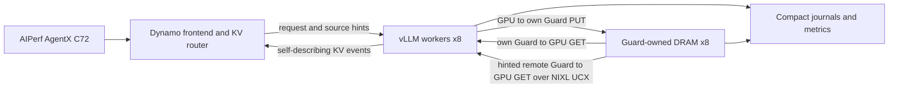

# What this benchmark deploys

The implementation is the published direct Guard path, rather than the earlier host-staged Guard or the proposed always-serving independent store. Each of eight data-parallel workers owns GPU KV pages and has a corresponding 124 GiB Guard pool. The framework host payload tier is disabled. Worker-side progress handles Guard-owned READY claims and NIXL work without calling back into vLLM to pin a framework host cache.



The diagram shows logical flows. All workers and Guard pools run in one Kubernetes pod/node. NIXL payload transfers are constrained to the single selected HCA; control and metadata traffic use local sockets/TCP/ZMQ. Hints identify candidate source ownership; successful acquisition still requires source-confirmed READY keys with compatible KV-group geometry. The metadata inventory gate and `opportunistic_query=false` avoid treating an arbitrary source's blocks as explicit router hints.

The registered vLLM connector and spec live under:

```text
vllm/distributed/kv_transfer/kv_connector/v1/kvcr/guard_direct/
```

Relevant modules include `connector.py` (framework integration), `spec.py` (configuration and manager/worker construction), `worker.py` (GPU region registration, actor/progress and attestations), and `router_geometry.py` (self-describing block/group events). KVCR's `guard.py`, `guard_protocol.py`, remote source operations and compact telemetry implement Guard lifecycle, READY export claims, native transfers, and timing/error accounting. Inspect the synced pinned code rather than current upstream main.

The detailed published design is on the separate [vLLM documentation branch](https://github.com/hxieustc/vllm/blob/harryx/guard-direct-docs/docs/design/kvcr_guard_direct.md). This manifest uses the code branch; test-specific configuration here is authoritative for reproduction.

`run.sh plan` emits all service argv and an explicit environment whitelist. `config/kv-transfer.json` defines zero host bytes, 124 GiB Guard bytes, Guard-only sources, disabled opportunistic queries, hint geometry, metadata batch limits, control ports, and transfer timeout policy. `config/worker-args.json` defines serving parameters; `compilation-config.json` separately exposes the same graph-capture configuration embedded in those arguments. The runner replaces only run-specific socket paths. `experiment.json` defines the exact AgentX/router workload, and `pins.json` defines source/image/wheel/data versions.

The Kubernetes template starts an idle container with shared workspace/model PVCs and RDMA character devices. The benchmark supervisor launches Guard, frontend, workers, and observers as owned process groups inside that container. Service shutdown does not end the idle container. This separates a failed benchmark attempt from pod allocation and keeps its evidence available.
